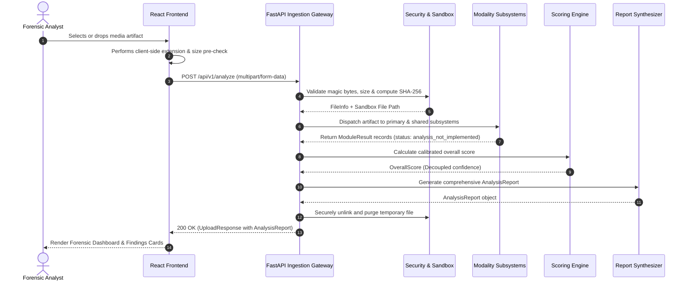

# DEEPFAKE X — System Architecture & Forensic Engineering Design

## 1. Executive Summary

**DEEPFAKE X** is an open-architecture, multimodal synthetic media forensics and authenticity verification platform. Unlike conventional binary deepfake classifiers that produce opaque, uncalibrated probability scores, DEEPFAKE X evaluates media across multiple physical, frequency, and cryptographic layers, providing human-interpretable evidence and explainable forensic reports.

```
                           +----------------------------------------+
                           |     DEEPFAKE X React Web Client        |
                           |   (Vite + TypeScript + Tailwind CSS)   |
                           +-------------------+--------------------+
                                               |
                                     REST / Multipart HTTP
                                               |
                                               v
                           +----------------------------------------+
                           |       FastAPI Gateway (Port 8000)      |
                           +-------------------+--------------------+
                                               |
                    +--------------------------+--------------------------+
                    |                                                     |
                    v                                                     v
      +----------------------------+                        +----------------------------+
      |  Security & Ingest Guard   |                        |   Forensic Module Router   |
      | - MIME & Magic Validation  |                        | - Ingest Orchestrator      |
      | - Path Sanitization        |                        | - Modality Dispatch        |
      | - SHA-256 Digesting        |                        | - Async Job Registry       |
      | - Sandbox Isolation        |                        +--------------+-------------+
      +----------------------------+                                       |
                                                                           |
         +-----------------------------------------------------------------+
         |
         +--> [ Image Subsystem ]        --> (ELA, FFT Residuals, PRNU Sensors) [Phase 2]
         +--> [ Video Subsystem ]        --> (Optical Flow, Facial Jitter)       [Phase 2]
         +--> [ Audio Subsystem ]        --> (LFCC, Vocoder Spectral Footprint)  [Phase 2]
         +--> [ Document Subsystem ]     --> (PDF Stream Parsing, Font Embeds)  [Phase 2]
         +--> [ Provenance Subsystem ]   --> (C2PA Manifests, EXIF/XMP Audits)   [Phase 2]
         +--> [ Cross-Modal Subsystem ]  --> (AV LipSync, Multimodal Alignment)  [Phase 2]
                                                   |
                                                   v
                                 +-----------------------------------+
                                 |  Calibrated Risk Scoring Engine   |
                                 |  (Decoupled Detector Confidence)  |
                                 +-----------------+-----------------+
                                                   |
                                                   v
                                 +-----------------------------------+
                                 |   Explainable Report Synthesizer  |
                                 |   (Evidence, Findings, Summary)   |
                                 +-----------------------------------+
```

---

## 2. Core Architectural Philosophy

### 2.1 Decoupling Model Confidence from Forensic Risk
In production digital forensics, presenting an uncalibrated neural classifier output as an absolute probability of manipulation is dangerous. Neural networks are susceptible to out-of-distribution shifts caused by social media recompression, camera quantization, and noise.

DEEPFAKE X strictly enforces architectural decoupling:
1. **Raw Model Confidence**: Tracked in `ModuleResult.model_confidence` as an isolated heuristic observation.
2. **Holistic Risk Score (0–100)**: Derived through weighted rule aggregation across multiple orthogonal forensic dimensions (container metadata, spatial artifacts, frequency distributions, and temporal stability).

### 2.2 Explainable Findings vs. Black-Box Classification
Every anomaly flagged by the engine generates a structured `Finding` linked to underlying empirical `Evidence` data points, complete with an explainable technical rationale.

---

## 3. Subsystem Breakdown

### 3.1 Frontend Layer (`/frontend`)
- **Framework**: React 19 + TypeScript + Vite.
- **Styling**: Tailwind CSS v4 with dark cybersecurity theme and monospace data formatting.
- **State & Ingestion**: Responsive drag-and-drop intake, instant format validation, real-time stage progression visualizer.
- **Reporting**: Dynamic risk gauge, module accordion views, empirical evidence inspector, and JSON report export.

### 3.2 Ingestion & Defensive Security Layer (`backend/app/security.py`)
- **Binary Magic Header Verification**: Rejects files whose binary signatures do not match their extensions (e.g., preventing executable masquerading as PNG).
- **Streaming Cryptographic Digest**: Computes SHA-256 hashes during ingestion without loading unbounded payloads into memory.
- **Filesystem Isolation**: Ephemeral storage inside `temp/uploads/` with UUID v4 filenames; automatic cleanup in `finally` blocks.
- **Configurable Thresholds**: Enforces payload size caps (default: 50MB) and strict extension white-listing.

### 3.3 Modular Forensic Subsystems (`backend/app/modules/`)
Each subsystem adheres to a strict contract returning a standardized `ModuleResult`:
- `image.py`: Raster dimensions, ELA, and spatial frequency residuals.
- `video.py`: Container metadata, temporal facial landmarks, and optical flow continuity.
- `audio.py`: Cepstral analysis, vocoder acoustic artifacts, and voice cloning markers.
- `document.py`: PDF stream structure, font embedding anomalies, and revision history.
- `provenance.py`: C2PA Content Credentials and EXIF/XMP auditing.
- `cross_modal.py`: Inter-modality alignment (e.g., AV-LipSync, text-image coherence).

*Note: In Phase 1, all forensic modules return an explicit `status: "analysis_not_implemented"` with structural baseline information.*

### 3.4 Evidence Scoring Engine (`backend/app/scoring.py`)
- Combines module outputs, counts verified findings, and maps severity to a 0–100 calibrated risk index.
- In Phase 1, correctly reports `risk_level: "inconclusive"` to avoid fabricating synthetic alerts.

---

## 4. Multi-Stage Ingestion Pipeline Flow



---

## 5. Security & Threat Model

| Threat | Mitigation Strategy | Implemented In |
|---|---|---|
| **Extension Masquerading (Spoofing)** | Header magic byte signature verification before filesystem writing | `backend/app/security.py` |
| **Path Traversal Attacks** | Filename base-name sanitization and UUID-based isolated paths | `backend/app/security.py` |
| **Denial of Service (Memory Exhaustion)** | Chunked stream processing with cumulative upload threshold enforcement | `backend/app/security.py` |
| **Persistent Data Exposure** | Deterministic ephemeral cleanup in ASGI `finally` handlers | `backend/app/main.py` |
| **CORS Misconfiguration** | Strict origin white-listing via environment-driven settings | `backend/app/config.py` |

---

## 6. Phased Evolution Roadmap

- **Phase 1 (Completed & Verified)**: Foundational architecture, unified Pydantic schemas, defensive ingestion gateway, security sandbox, dark forensic UI, and test suite.
- **Phase 2 (Next Milestone)**: Classical DSP heuristics (2D-FFT, Error Level Analysis, PyMuPDF object parsing, and Librosa spectral flux).
- **Phase 3**: Integration of deep neural networks (FSD frequency-spectrum detector, facial landmark jitter, and neural vocoder analysis).
- **Phase 4**: C2PA cryptographic provenance parsing and asynchronous distributed workers (Celery/Redis).
